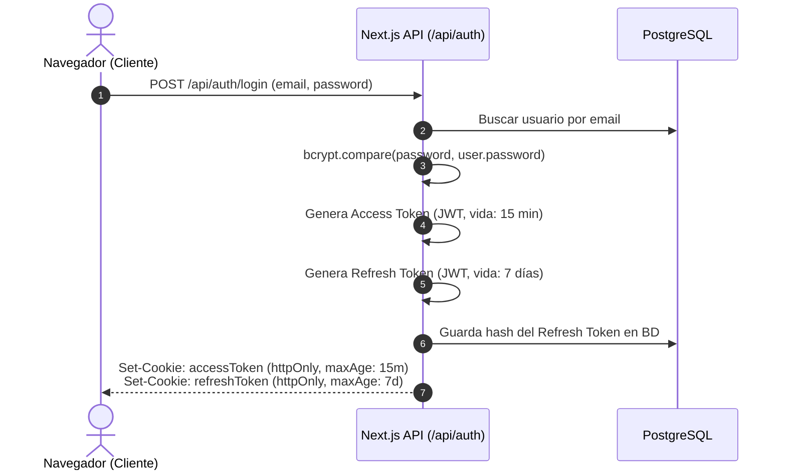

# 🎓 Guía Maestra de Estudio y Sustentación: CoSpace (cospace-nxt)

> Documento diseñado para preparar la sustentación técnica, defensa de proyecto o examen de arquitectura sobre **CoSpace**. Contiene explicaciones claras, preguntas trampa típicas de evaluadores y respuestas técnicas bien fundamentadas.

---

## 📑 Índice de Navegación

1. [El Proyecto en 2 Minutos (Elevator Pitch)](#1-el-proyecto-en-2-minutos-elevator-pitch)
2. [Prisma ORM al Detalle (Lo que se usó y por qué)](#2-prisma-orm-al-detalle-lo-que-se-usó-y-por-qué)
3. [Manejo de Errores y Resiliencia](#3-manejo-de-errores-y-resiliencia)
4. [Seguridad y Protección de Datos](#4-seguridad-y-protección-de-datos)
5. [Las 14 Reglas de Negocio Explicadas](#5-las-14-reglas-de-negocio-explicadas)
6. [Arquitectura Frontend y Prevención de Hydration Mismatch](#6-arquitectura-frontend-y-prevención-de-hydration-mismatch)
7. [Banco de Preguntas Típicas de Sustentación (con Respuestas de 10)](#7-banco-de-preguntas-típicas-de-sustentación-con-respuestas-de-10)

---

## 1. El Proyecto en 2 Minutos (Elevator Pitch)

### ¿Qué es CoSpace?
Es una aplicación web **Full-Stack** construida sobre **Next.js 16 (App Router)**, **PostgreSQL** y **Prisma ORM 7**, diseñada para resolver de manera automatizada la reserva y administración de espacios de coworking (hot desks, salas de juntas y cabinas telefónicas).

### ¿Cuál es el problema que resuelve?
Evita el solapamiento de horarios (overbooking), bloquea manipulaciones fraudulentas de precios desde el navegador, previene cancelaciones de último minuto y garantiza que los datos de los usuarios permanezcan aislados mediante seguridad basada en tokens y roles (RBAC).

---

## 2. Prisma ORM al Detalle (Lo que se usó y por qué)

En este proyecto se utilizó la versión más reciente: **Prisma 7.10.1**.

### 📦 Paquetes instalados y para qué sirve cada uno

| Paquete | Tipo | Propósito |
| :--- | :--- | :--- |
| `prisma` | `devDependencies` | Herramienta CLI para ejecutar migraciones (`migrate`), introspección y generación de tipos (`generate`). |
| `@prisma/client` | `dependencies` | Librería que se importa en el código (`import { PrismaClient }`) para hacer consultas con tipado TypeScript automático. |
| `@prisma/adapter-pg` | `dependencies` | Driver Adapter oficial de Prisma 7. Permite desacoplar el motor interno de Prisma y usar el driver nativo de Node.js `pg`. |
| `pg` & `@types/pg` | `dependencies` | Driver nativo de PostgreSQL para Node.js. Gestiona el pool de conexiones (`Pool`) con alta concurrencia y bajo consumo de memoria. |

---

### 💡 ¿Por qué se usó `@prisma/adapter-pg` y el Connection Pool?
En Prisma clásico (versiones anteriores), Prisma abría sus propias conexiones usando un motor binario en Rust (Query Engine).  
En **Prisma 7**, se introdujo la arquitectura de **Driver Adapters**:
1. Conectamos Prisma a través de un pool nativo de Node.js (`new Pool({ connectionString })` de la librería `pg`).
2. Esto es vital para entornos **Serverless / Edge / Cloud** (como Supabase o Vercel) porque evita saturar el límite de conexiones de la base de datos PostgreSQL.
3. Permite operar fluidamente con PgBouncer (Transaction Pooler).

---

### 🔌 ¿Por qué tenemos dos URLs: `DATABASE_URL` y `DIRECT_URL`?
Esta es una pregunta clásica de examen cuando se usa Supabase/PostgreSQL en la nube:

1. **`DATABASE_URL` (Puerto 6543 - PgBouncer / Transaction Mode)**:
   - Se usa para las operaciones habituales de la aplicación (`SELECT`, `INSERT`, `UPDATE`).
   - Comparte conexiones entre miles de peticiones sin agotar los sockets de PostgreSQL.
2. **`DIRECT_URL` (Puerto 5432 - Conexión directa a PostgreSQL)**:
   - Se usa **exclusivamente para migraciones DDL** (`prisma migrate`, `prisma db push`) y scripts de inicialización (`seed.ts`).
   - **Razón técnica**: Los poolers en modo transacción (PgBouncer) no soportan sentencias preparadas complejas (*prepared statements*) ni bloqueos a nivel de tabla necesarios para alterar el esquema.

---

### 📐 Anatomía de los Modelos en `prisma/schema.prisma`

#### 1. Modelo `User`
```prisma
model User {
  id                 String        @id @default(uuid())
  email              String        @unique
  password           String        // Hash bcrypt (cost factor 10)
  name               String
  role               Role          @default(USER) // Enum: USER | ADMIN
  hashedRefreshToken String?       @map("hashed_refresh_token")
  reservations       Reservation[] // Relación 1 a N
  ...
}
```

#### 2. Modelo `Space`
```prisma
model Space {
  id           String        @id @default(uuid())
  name         String
  type         SpaceType     @default(DESK) // Enum: DESK | MEETING_ROOM | BOOTH
  description  String
  capacity     Int
  pricePerHour Decimal       @map("price_per_hour") @db.Decimal(10, 2)
  imageUrl     String?       @map("image_url")
  isActive     Boolean       @default(true) // Soft-delete flag
  reservations Reservation[]
  ...
}
```

#### 3. Modelo `Reservation`
```prisma
model Reservation {
  id         String            @id @default(uuid())
  userId     String            @map("user_id")
  spaceId    String            @map("space_id")
  startTime  DateTime          @map("start_time")
  endTime    DateTime          @map("end_time")
  totalPrice Decimal           @map("total_price") @db.Decimal(10, 2)
  status     ReservationStatus @default(CONFIRMED) // CONFIRMED | CANCELLED
  
  user  User  @relation(fields: [userId], references: [id], onDelete: Cascade)
  space Space @relation(fields: [spaceId], references: [id], onDelete: Restrict)

  @@index([spaceId, startTime, endTime]) // Índice compuesto de alta velocidad
}
```

#### 🔑 Puntos de Arquitectura de Base de Datos para Sustentar:
- **`onDelete: Restrict` en Space**: Si un espacio tiene reservas históricas, la base de datos prohíbe físicamente borrar el espacio para evitar dejar reservas huérfanas. Se usa desactivación lógica (`isActive: false`).
- **`onDelete: Cascade` en User**: Si se elimina la cuenta de un usuario, se eliminan sus reservas asociadas.
- **`@@index([spaceId, startTime, endTime])`**: Índice compuesto en PostgreSQL que optimiza las consultas de solapamiento de horarios en microsegundos, sin escanear toda la tabla.

---

## 3. Manejo de Errores y Resiliencia

El proyecto no deja que la aplicación "truene" con pantallas blancas ni que exponga trazas de error internas de Node.js al usuario final.

### Estrategia de Códigos HTTP Semánticos en Backend

| Código | Significado | Caso de Uso en CoSpace |
| :---: | :--- | :--- |
| `200` | OK | Login exitoso, listado de reservas, cancelación exitosa. |
| `201` | Created | Creación de una nueva reserva o registro de usuario. |
| `400` | Bad Request | Minutos no son `00`, duración fuera de 1-4 hrs, o cancelación con menos de 2 hrs. |
| `401` | Unauthorized | Falta de token de sesión, token expirado o firma inválida. |
| `403` | Forbidden | Un usuario normal intentando acceder a rutas de administración o cancelar reservas de otro. |
| `404` | Not Found | Espacio o reserva con ese ID no existe. |
| `409` | Conflict | Espacio ya ocupado en ese horario, o intento de desactivar un espacio con reservas futuras. |
| `500` | Internal Error | Error de conexión a la base de datos o excepción no controlada en el servidor. |

### Filosofía Fail-Fast (Falla Rápido)
En `src/app/api/reservations/route.ts`:
1. Primero valida la autenticación. Si falla, corta inmediatamente con `401`.
2. Luego valida las reglas de entrada numéricas y de fecha (formato, horas en punto, límites de 1 a 4 horas). Si falla, corta con `400` sin consultar la base de datos (ahorro de recursos).
3. Luego valida en base de datos la existencia del espacio y los solapamientos. Si hay conflicto, corta con `409`.
4. Solo cuando todas las condiciones se cumplen, se ejecuta el `db.reservation.create`.

---

## 4. Seguridad y Protección de Datos

### A. Estrategia de Autenticación Dual (Access Token + Refresh Token)
No se usa una sesión de 30 días con un solo token, porque si te lo roban tendrían acceso indefinido. Se implementó el estándar de seguridad industrial:



1. **Access Token (15 minutos)**:
   - Vida muy corta. Si es interceptado, expira rápidamente.
2. **Refresh Token (7 días)**:
   - Permite al usuario mantenerse conectado sin reescribir su contraseña.
   - **Clave de seguridad**: No se guarda en texto plano en la base de datos; se guarda **hasheado con bcrypt**. Si la base de datos es vulnerada, los atacantes no pueden usar los tokens.
   - Cuando el usuario hace `logout`, el token se borra y puede invalidarse inmediatamente.

### B. Cookies `httpOnly`, `SameSite=Lax` y `Secure`
- **`httpOnly: true`**: JavaScript en el navegador (incluso código malicioso inyectado vía XSS) **no puede leer** `document.cookie`. El token está blindado contra robo por scripts.
- **`sameSite: "Lax"`**: Protege contra ataques CSRF (Cross-Site Request Forgery) al impedir que sitios externos envíen cookies en solicitudes cross-origin inseguras.
- **`secure: true`**: Solo viaja sobre conexiones cifradas HTTPS en producción.

### C. Protección IDOR (Insecure Direct Object Reference)
- En `GET /api/reservations`, el código **nunca** confía en parámetros de la URL como `?userId=123`.
- Extrae el ID del usuario **directamente del payload verificado criptográficamente del token JWT** (`session.id`). Es imposible que un usuario suplante a otro para ver sus reservas.

### D. Integridad Financiera Backend-Only
- El cliente **no envía el total ni el precio por hora**. Solo envía `spaceId`, `startTime` y `endTime`.
- El backend consulta el precio oficial en la base de datos y ejecuta la fórmula matemática:
  $$\text{totalPrice} = \text{durationHours} \times \text{space.pricePerHour}$$
- Esto neutraliza el ataque de "Inspeccionar Elemento" donde un usuario altera el precio a `0.01` en el navegador.

---

## 5. Las 14 Reglas de Negocio Explicadas

Si en la sustentación te piden explicar las reglas de negocio, utiliza esta tabla resumen:

```text
┌────────┬─────────────────────────┬────────────────────────────────────────────────────────┐
│ Regla  │ Nombre Corto            │ Propósito Técnico                                      │
├────────┼─────────────────────────┼────────────────────────────────────────────────────────┤
│  R1    │ Duración 1 a 4 horas    │ Bloquea reservas fraccionadas; minutos estrictos en :00│
│  R2    │ Horario 07:00 - 21:00   │ Franja operativa UTC; no reservas nocturnas            │
│  R3    │ Ventana 30 días         │ No fechas pasadas ni reservas a más de un mes          │
│  R4    │ No Solapamiento Espacio │ Bloquea overbooking del mismo espacio                  │
│  R5    │ No Solapamiento Usuario │ Un usuario no puede estar en 2 espacios a la vez       │
│  R6    │ Límite 3 reservas       │ Máximo 3 reservas futuras activas por usuario          │
│  R7    │ Espacio Activo          │ Requiere isActive = true                               │
│  R8    │ Total en Backend        │ Cálculo de precio seguro contra manipulación en cliente│
│  R9    │ Autorización Cancelar   │ Solo el creador de la reserva o un ADMIN pueden anular │
│  R10   │ 2 horas de anticipación │ Usuarios normales no pueden cancelar sobre la hora     │
│  R11   │ Cancelación Lógica      │ status = 'CANCELLED' (auditoría preservada)            │
│  R12   │ Doble Token JWT         │ Access Token 15m + Refresh Token 7d en BD con bcrypt   │
│  R13   │ Desactivación Segura    │ Espacio no puede apagarse si tiene reservas futuras    │
│  R14   │ Aislamiento por Token   │ GET filtra obligatoriamente por ID de sesión           │
└────────┴─────────────────────────┴────────────────────────────────────────────────────────┘
```

---

## 6. Arquitectura Frontend y Prevención de Hydration Mismatch

### ¿Qué es un Hydration Mismatch y cómo se solucionó?
En Next.js (SSR), el servidor renderiza HTML en un huso horario (ej. UTC en Vercel) y el navegador lo hidrata en el huso horario local del usuario (ej. GMT-5 Colombia/México).  
Si renderizas directamente `new Date(date).toLocaleString()`, el HTML del servidor diferirá del cliente, arrojando el error:  
`Error: Text content does not match server-rendered HTML`.

### La Solución en CoSpace:
Creamos el componente defensivo [src/components/local-date.tsx](file:///c:/Users/garci/cospace-nxt/src/components/local-date.tsx):
```tsx
"use client";
import { useState, useEffect } from "react";

export function LocalDate({ date }: { date: string | Date }) {
  const [isMounted, setIsMounted] = useState(false);

  useEffect(() => setIsMounted(true), []);

  if (!isMounted) return <span className="opacity-0">Cargando fecha...</span>;

  return <span>{new Date(date).toLocaleString()}</span>;
}
```
- **Mecanismo**: El primer renderizado en cliente y servidor coincide perfectamente. Solo tras el montaje en el navegador (`useEffect`), se activa el formateo en la hora local del usuario sin discrepancias de hidratación.

---

## 7. Banco de Preguntas Típicas de Sustentación (con Respuestas de 10)

### P1: ¿Por qué eligieron Next.js 16 App Router sobre Create React App o Vite + Express?
> **Respuesta:**  
> Next.js App Router unifica Frontend y Backend en una sola solución con soporte de Server Components y Route Handlers. Nos permite ejecutar Server-Side Rendering (SSR) dinámico para el catálogo de espacios (vía `connection()`), optimizando SEO y tiempo de carga inicial, al tiempo que exponemos APIs seguras sin necesidad de gestionar dos repositorios ni lidiar con problemas de CORS entre cliente y servidor.

### P2: ¿Cómo evitan que dos usuarios reserven el mismo espacio en el mismo segundo exacto?
> **Respuesta:**  
> Aplicamos la Regla 4 mediante una consulta de verificación de rango temporal con operadores de solapamiento (`startTime < end && endTime > start`) buscando reservas con estado `CONFIRMED`. Además, en la base de datos PostgreSQL tenemos un índice compuesto sobre `(space_id, start_time, end_time)` que optimiza la búsqueda de concurrencia.

### P3: ¿Por qué usan `prisma db push` y también migraciones?
> **Respuesta:**  
> Durante la etapa de prototipado rápido usamos `prisma db push` para sincronizar directamente el esquema sin acumular archivos de historial. Para producción, utilizamos `prisma migrate deploy`, el cual ejecuta el historial de migraciones versionadas en SQL de forma predecible y sin alterar los datos existentes.

### P4: ¿Por qué las contraseñas se almacenan con Bcrypt y no con SHA-256 o MD5?
> **Respuesta:**  
> SHA-256 y MD5 son algoritmos de hash rápido diseñados para verificación de integridad; un atacante con tarjetas gráficas modernas puede probar miles de millones de combinaciones por segundo mediante ataques de fuerza bruta o Rainbow Tables. Bcrypt es una función deliberadamente lenta (*key derivation function*) con factor de trabajo ajustable (usamos 10 rondas de salteo) que incorpora *salt* criptográfico aleatorio, volviendo inviables los ataques por diccionario.

### P5: ¿Cómo garantizan que un usuario regular no entre al panel de administración?
> **Respuesta:**  
> Implementamos seguridad en dos capas:
> 1. **Perimetral en Edge (`middleware.ts`)**: Antes de que la página cargue, intercepta cualquier ruta bajo `/admin/:path*`, valida la firma criptográfica del JWT y verifica si `payload.role === 'ADMIN'`. Si no lo es, redirige al `/dashboard`.
> 2. **En la API (`validateAdminRoute` en `server-auth.ts`)**: Cualquier endpoint que cree espacios o desactive recursos verifica en servidor el rol antes de procesar la petición, respondiendo `403 Forbidden` si el rol no es administrador.

